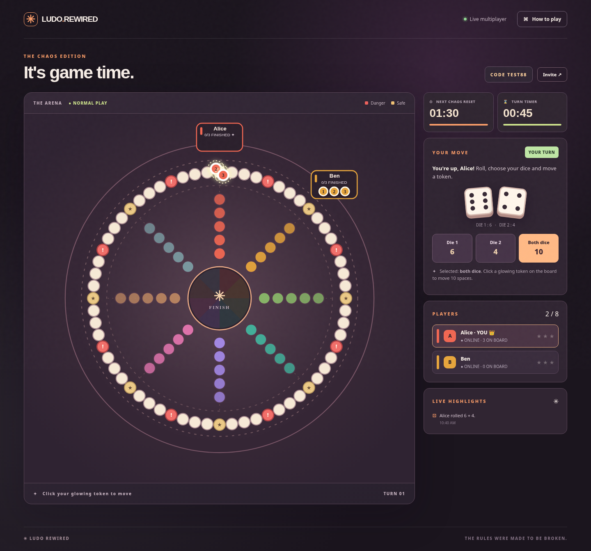

# LUDO REWIRED — The Chaos Edition

**Ready to deploy online!** See [DEPLOY-ONLINE.md](DEPLOY-ONLINE.md) for the Render setup steps (free plan where available). The included `render.yaml` configures a public Node.js Web Service with WebSocket support. This project is not publicly hosted until you complete deployment in your hosting account.

A real-time, turn-based, multiplayer Ludo-inspired browser game for **2–8 players**. It has **no external Node.js dependencies**, so you can run it immediately with Node.js 20 or newer.



## Quick start (Windows / VS Code)

1. Download and unzip `ludo-rewired.zip`.
2. Install **Node.js 20+** from https://nodejs.org/ if it isn't installed already.
3. Open the extracted `ludo-rewired` folder in VS Code.
4. Open the terminal (**Terminal → New Terminal**) and run:

   ```bash
   node server.js
   ```

5. Open **http://localhost:3000** in your browser.
6. Enter your name, create a room and copy the invitation code or link.
7. To test with two people on one computer, open a **fresh tab** at `http://localhost:3000/?room=YOURCODE`, enter a different name, and join. The host then starts the game.

Alternatively, on Windows double-click `start-windows.bat` after installing Node.js.

No `npm install` is needed. Run `npm test` to execute the automated tests.

## Play with friends on other devices

Everyone needs to access **the same running server**. On a home Wi-Fi network, find your computer's LAN IPv4 address (on Windows run `ipconfig`) and open `http://YOUR_LAN_IP:3000` on each device. You may need to allow incoming TCP port 3000 through your firewall.

For friends in different locations, deploy this project to an internet-accessible Node.js host that supports **long-lived WebSocket connections** (such as a suitable Node web service on Render, Railway, or a VPS). Use `node server.js` as the start command. The server reads `process.env.PORT` automatically. Share the resulting **HTTPS URL** or the in-game invite link. Room codes work only within the same deployment.

**Important:** This project is not hosted by ChatGPT. Downloading it does not automatically make an internet multiplayer server. The running server keeps rooms and games **in memory**, so rooms disappear when it restarts. Rooms with no connected users expire after about 30 minutes. This is a playable MVP, not a commercial-scale game service.

## All mechanics

- **Eight-player arena:** each player has a private starting area, three tokens and a finish lane. The custom circular board has 64 shared spaces and five private finish-lane spaces per player.
- **Two dice per turn:** two six-sided dice roll every turn. Choose **Die 1**, **Die 2**, or **Both** (their sum), then click one glowing token. A selected die must include a **6** to launch a token from base. Launching a token uses the chosen movement for entry, placing it on its start square. Tokens must make one full circuit and reach the center to finish; overshooting is permitted.
- **Doubles powers:** matching dice unlock one selected reward:
  - **Extra turn:** play again after this move.
  - **25-second shield:** active tokens cannot be captured, danger-reset or chaos-reset during the next 25 seconds.
  - **Lifeline:** choose a token; the next capture, danger-reset or chaos-reset affecting it is prevented once.
  - **+2 Boost:** add two steps to the selected movement.
  - **Danger cleanse:** remove all of your tokens' current danger warnings.
- **Chaos reset:** every **60, 90, 120 or 180 seconds**, the leading active token (the one furthest along) of each team is targeted and sent to base, unless protected. Protected finished tokens are never sent back.
- **Danger zones:** eight red squares. If a token lands on one, it has **two subsequent turns of its owner** to leave the dangerous square. If it remains there, it returns to base. Moving a different token counts as a turn.
- **Captures:** a token landing on an opponent's square sends that opponent to base, unless the square is marked as safe or the opposing token is protected.
- **Reverse mode:** when any player finishes **two of their three tokens**, reverse mode activates **once** for the next eight completed turns, including turns passed. Tokens move backward during those turns. Tokens at the start cannot move further backward; base tokens cannot launch until reverse ends.
- **Victory:** finish all three of your tokens first. The host can request a rematch after the game.
- **Turn timeout:** a 45-second timer advances the turn if a player does not complete their move. Use the **Pass** button when there are no legal moves.

## Project files

```text
ludo-rewired/
├─ render.yaml               # One-click Render Blueprint setup
├─ DEPLOY-ONLINE.md          # Step-by-step instructions for public hosting
├─ server.js                 # Node HTTP + native WebSocket game room server
├─ game.js                   # Server-authoritative game rules
├─ public/
│  ├─ index.html             # Interface and rules
│  ├─ styles.css             # Responsive visual design
│  └─ app.js                 # Client-side board, interactions and Socket messages
├─ tests/
│  ├─ game.test.js           # Unit tests
│  └─ server.test.js         # Real WebSocket integration test
├─ screenshots/
│  └─ game-preview.png
├─ package.json
├─ start-windows.bat
└─ README.md
```

## Architecture and limitations

The Node server is **authoritative**: it chooses dice, validates player turns, checks legal moves, applies power-ups and broadcasts the synchronized state. Players are assigned a random player ID and secret on joining; the secret remains stored in that tab's `sessionStorage` so a page refresh can rejoin without taking an additional seat. Do not share this secret. Room codes are intended for casual private play, not sensitive or secure matchmaking.

This custom eight-sided board is **Ludo-inspired**, not a pixel-for-pixel classic four-color Ludo board. It uses three tokens per player, simplified token-launch rules, and no exact-roll-to-finish restriction for faster eight-player play. There are no bots, public matchmaking, persistent accounts, database, chat, spectator-only mode, or mobile app package. Google Fonts are optional; the game works with system fallback fonts if offline.

To run on another port, use `PORT=4000 node server.js` on macOS/Linux, or in Windows PowerShell `$env:PORT=4000; node server.js`.

## Testing

```bash
npm test
```

The included automated tests verify maximum room capacity, die selection, launching, doubles, timed shields, dangers and lifelines, captures, reset intervals, reverse movement, winning, rematches, timeouts, real room joins and turn enforcement.
